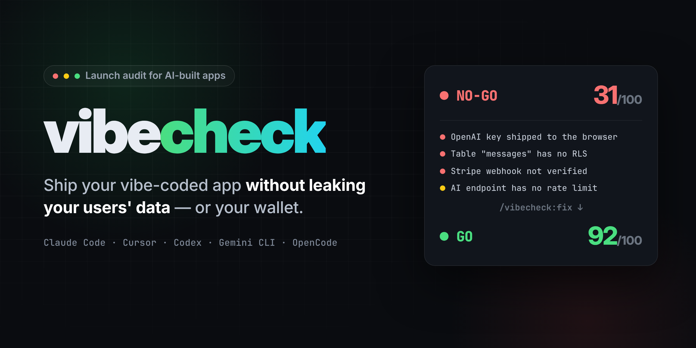
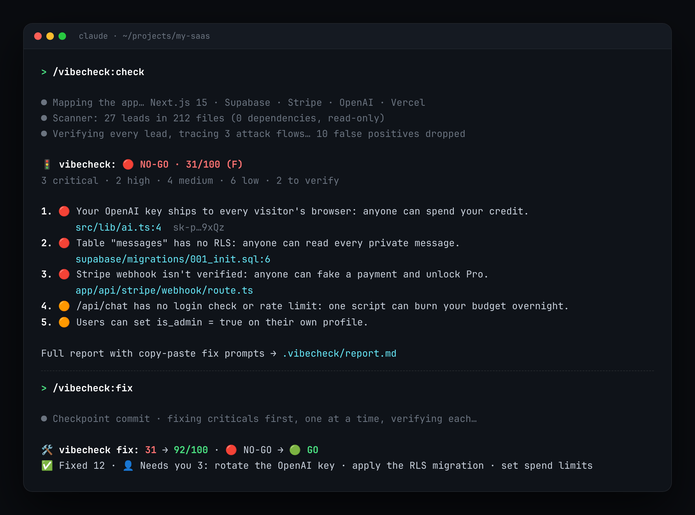

<p align="center">
  
</p>

<p align="center">
  <b>AI yang menulis aplikasimu. vibecheck memastikan aplikasinya tidak membocorkan data pengguna, atau isi dompetmu.</b>
</p>

<p align="center">
  <a href="#instalasi">Instalasi</a> ·
  <a href="#apa-saja-yang-dicek">Apa saja yang dicek</a> ·
  <a href="#perintah">Perintah</a> ·
  <a href="#guard-selalu-aktif">Guard</a> ·
  <a href="#pakai-di-ci">CI</a> ·
  <a href="README.md">🇬🇧 English</a>
</p>

---

Januari 2026, sebuah media sosial hasil vibe coding membocorkan **1,5 juta API token dan 35.000 email**. Penyebabnya satu key Supabase yang ada di front-end, sementara Row Level Security (RLS) dalam keadaan mati ([Wiz](https://www.wiz.io/blog/common-security-risks-in-vibe-coded-apps), [Infosecurity](https://www.infosecurity-magazine.com/news/moltbook-exposes-user-data-api/)). Tahun 2025, **170+ aplikasi Lovable** rilis dengan celah yang sama ([CVE-2025-48757](https://nvd.nist.gov/vuln/detail/CVE-2025-48757)). Setiap minggu ada saja yang baru sadar API key OpenAI-nya ikut ke bundle JavaScript setelah melihat tagihan.

AI menulis kode yang **jalan**. Tidak ada yang mengecek apakah kodenya **aman**. vibecheck adalah senior engineer yang me-review aplikasimu sebelum deploy, dengan bahasa yang mudah dipahami dan perbaikan yang siap ditempel.

<p align="center"></p>

<p align="center"><a href="examples/sample-report.md">📄 Lihat contoh laporan lengkap</a></p>

## Yang kamu dapat

- 🚦 **Launch Score dan putusan.** Skor 0 sampai 100, plus 🔴 NO-GO, 🟡 FIX FIRST atau 🟢 GO, jadi kamu tahu apakah aplikasimu boleh rilis hari ini.
- 🔍 **Audit sungguhan, bukan sekadar regex.** Scanner tanpa dependency (60+ pengecekan) menemukan petunjuk dengan cepat. Lalu agent AI-mu membaca kodenya untuk memverifikasi setiap temuan, menelusuri alur serangan seperti "bisakah user A membaca data user B?", dan membuang false positive.
- 🗣️ **Bahasa manusia.** Setiap temuan dimulai dengan *apa yang bisa terjadi* ("siapa pun bisa membaca semua pesan pribadi"), baru detail teknisnya. Laporan ditulis dalam bahasa yang kamu pakai, termasuk Bahasa Indonesia.
- 📋 **Prompt perbaikan siap tempel.** Setiap temuan punya prompt siap pakai untuk Claude Code, Cursor, Lovable, Bolt, v0 atau Replit, jadi tetap berguna walau aplikasimu dibuat di no-code builder.
- 🛠️ **`/vibecheck:fix`.** Memperbaiki satu per satu, yang kritis dulu, memverifikasi setiap perbaikan, dan tidak pernah "memperbaiki" dengan cara melemahkan keamanan.
- 🛡️ **Guard yang selalu aktif.** Hook yang mencegah agent menulis API key langsung di kode atau meng-commit `.env`, *sebelum* terjadi.
- 🧭 **`/vibecheck:unstuck`.** Memutus "AI fix loop" saat bug yang sama terus muncul lagi.

## Apa saja yang dicek

| Area | Contoh |
|---|---|
| 🔑 **Secret** | Key OpenAI / Anthropic / Stripe / AWS / Supabase di kode; secret di balik `NEXT_PUBLIC_` / `VITE_` / `EXPO_PUBLIC_`; `.env` ter-commit sekarang atau di riwayat git |
| 🗄️ **Database** | Tabel Supabase tanpa RLS, policy `using (true)`, user bisa mengubah `is_admin` miliknya sendiri, policy yang percaya `user_metadata`; rules Firebase "test mode" atau terbuka; key service-role di kode browser |
| 🔐 **Auth** | API route dan server action tanpa pengecekan di server, IDOR (bisa membaca data orang lain), admin cuma ditandai di client, auth yang hanya di middleware, `jwt.decode` tanpa verifikasi |
| 💸 **Uang** | Panggilan AI dari browser (`dangerouslyAllowBrowser`), API berbayar tanpa rate limit ("denial of wallet"), harga diambil dari request, webhook Stripe / **Midtrans** / **Xendit** tidak diverifikasi, premium terbuka hanya dengan membuka URL sukses |
| 🧱 **Input** | SQL injection, mass assignment, XSS lewat `dangerouslySetInnerHTML` dan output AI, SSRF, shell injection, prompt injection lewat tools |
| 🚀 **Konfigurasi** | `CORS *` dengan credentials, mode debug, source map publik, verifikasi TLS dimatikan, security header kurang, package npm hasil halusinasi AI |
| 🛟 **Keandalan** | Tidak pakai git, tanpa backup, tanpa error monitoring, skema tidak ada di migration, tanpa lockfile |
| 🌍 **Launch** | Kebijakan privasi (UU PDP) dan syarat & ketentuan, hapus akun (wajib di App Store), OG tag, sitemap, robots, halaman 404, favicon, analytics, DNS email |

Cakupan paling dalam: **Next.js, React/Vite, Supabase, Firebase, Stripe, OpenAI/Anthropic/Gemini, Express, FastAPI/Flask/Django, Expo**, plus **Midtrans dan Xendit** untuk pembayaran Indonesia. Pengecekan umum tetap jalan di stack apa pun.

## Instalasi

### Claude Code (direkomendasikan: sudah termasuk guard hook)

```text
/plugin marketplace add ribato22/vibecheck
/plugin install vibecheck@vibecheck
```

### Cursor, Codex, Gemini CLI, OpenCode, Windsurf dan agent lain (skill saja)

```bash
npx skills add ribato22/vibecheck
```

### Manual

Salin folder di dalam `skills/` ke `~/.claude/skills/` (atau folder skill agent-mu).

## Perintah

| Perintah | Fungsi |
|---|---|
| `/vibecheck:check` | Audit lengkap → skor, putusan, dan `.vibecheck/report.md` berisi prompt perbaikan |
| `/vibecheck:check quick` | Cek 2 menit sebelum deploy: secret, akses database, dan temuan kritis |
| `/vibecheck:check security` | Area keamanan saja |
| `/vibecheck:check launch` | Checklist rilis (legal, SEO, monitoring) plus temuan kritis |
| `/vibecheck:fix` | Perbaiki yang kritis lalu yang tinggi, satu per satu, dengan skor sebelum → sesudah |
| `/vibecheck:fix VC-DB-NO-RLS` | Perbaiki satu temuan tertentu |
| `/vibecheck:unstuck` | Hentikan fix loop: reproduksi bug, cari akar masalah, buang tumpukan perbaikan gagal |

Tidak perlu dihafal. Tanya saja *"aplikasiku sudah siap rilis belum?"* atau bilang *"masih error, kamu muter-muter terus"*, dan skill yang tepat akan jalan sendiri. Di agent lain, panggil skill-nya dengan nama (`check`, `fix`, `unstuck`).

## Guard (selalu aktif)

Dengan plugin Claude Code, vibecheck mengawasi setiap penulisan file dan setiap `git commit` / `git push` yang dilakukan agent:

```text
vibecheck guard blocked this: it would put secrets where they do not belong.

  - OpenAI API key sk-p…9xQz in src/lib/ai.ts:3
  - NEXT_PUBLIC_OPENAI_API_KEY has a browser-public prefix, so its value ships to every visitor (.env:2)
```

Agent membaca pesan itu lalu memperbaikinya sendiri. Guard hanya memblokir format key yang pasti, mengizinkan secret di `.env`, dan memeriksa semua commit yang belum di-push (bukan cuma yang terakhir). Matikan false positive dengan komentar `vibecheck-ignore` di baris itu, atau matikan guard dengan `VIBECHECK_GUARD=off`.

## Pakai di CI

Scanner-nya satu file Node tanpa dependency:

```bash
node skills/check/scripts/scan.mjs ./my-app                     # tampilan untuk manusia
node skills/check/scripts/scan.mjs ./my-app --json              # untuk tools dan agent
node skills/check/scripts/scan.mjs . --fail-on critical         # exit 1 bila ada temuan kritis yang pasti
```

Contoh workflow GitHub Actions ada di [README bahasa Inggris](README.md#use-it-in-ci).

## Lulus? Pamerkan

Dapat 🟢 GO? Pasang badge ini di README-mu:

```markdown
[](https://github.com/ribato22/vibecheck)
```

Badge hanya untuk aplikasi yang GO. Badge "NO-GO" yang publik sama saja memberi tahu penyerang harus mencari ke mana.

## Aman sejak dirancang

Alat keamanan tidak boleh jadi sumber masalah keamanan.

- **Audit bersifat read-only.** Hanya menulis ke `.vibecheck/`, yang otomatis diabaikan git. Perbaikan hanya terjadi lewat `/vibecheck:fix`, setelah kamu setuju.
- **Tanpa dependency, tanpa koneksi jaringan**, dan tidak pernah menjalankan kode proyekmu. Sekitar 1.000 baris JavaScript biasa yang bisa kamu baca dalam 15 menit.
- **Secret selalu disamarkan** (`sk-p…9xQz`) di output, laporan dan pesan guard.
- **Guard bersifat fail-open.** Kalau guard error, pekerjaanmu tetap jalan.

Menemukan celah keamanan di vibecheck sendiri? Laporkan secara privat, lihat [SECURITY.md](SECURITY.md).

## FAQ

**Apakah ini pengganti penetration test?**
Bukan. vibecheck menangkap kesalahan yang paling sering dibuat AI, dan itu penyebab sebagian besar kebocoran aplikasi vibe coding. Kalau aplikasimu mengelola data kesehatan, keuangan atau anak-anak, tetap minta review profesional.

**Apakah kodeku dikirim ke mana-mana?**
Scanner tidak menyentuh jaringan sama sekali. Skill berjalan di dalam agent AI yang sudah kamu pakai, sama seperti prompt lain.

**Ada temuan yang sebenarnya aman.**
Tambahkan `// vibecheck-ignore` (atau `# vibecheck-ignore`) di baris itu. Taruh `vibecheck-ignore-file` di baris awal untuk melewati satu file, misalnya fixture test. Lalu buka issue supaya rule-nya diperbaiki.

**Aplikasiku dibuat di Lovable / Bolt / v0 / Replit.**
Export atau sinkronkan ke GitHub, buka dengan agent yang didukung, lalu jalankan check. Tempel prompt perbaikannya kembali ke builder-mu.

## Kontribusi

Rule baru, panduan stack, dan laporan false positive sangat diterima. Lihat [CONTRIBUTING.md](CONTRIBUTING.md). Jalankan test dengan `npm test` (Node 18+, tanpa install).

---

<p align="center">
  Kalau vibecheck menemukan masalah sebelum penggunamu menemukannya, beri ⭐ supaya builder lain juga bisa menemukannya.<br>
  <sub>MIT © kontributor vibecheck · Tidak berafiliasi dengan Anthropic, Supabase, Firebase, Stripe, Midtrans, Xendit, atau vendor lain yang disebut di sini.</sub>
</p>
